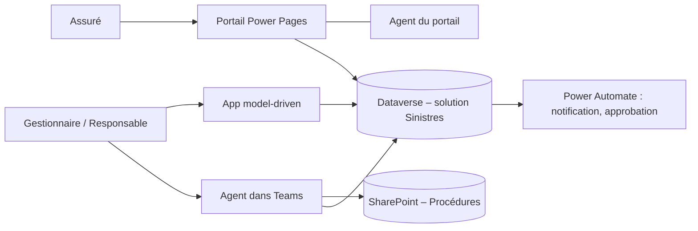
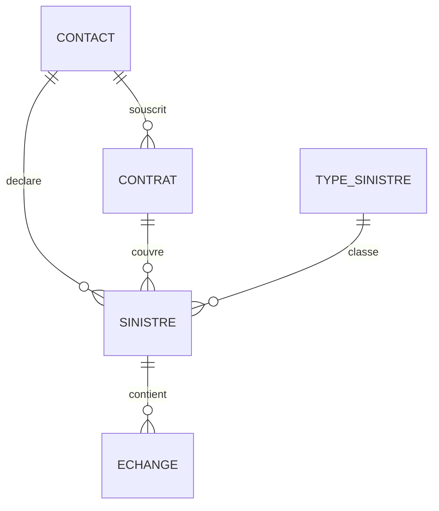

# Contoso Assurances – Déclaration de sinistres

Projet de démonstration sur la Power Platform : un portail où les assurés déclarent et suivent leurs sinistres, une application de gestion pour les équipes internes et deux agents Copilot Studio, le tout livré dans une solution et déployé par pipeline.

> Projet personnel, construit dans un environnement de développement. Les données et l'entreprise sont fictives.

## Sommaire

- [Contexte](#contexte)
- [Personas](#personas)
- [Récits utilisateur](#récits-utilisateur)
- [Architecture](#architecture)
- [Modèle de données](#modèle-de-données)
- [Règles métier](#règles-métier)
- [Écrans](#écrans)
- [Sécurité](#sécurité)
- [ALM et gouvernance](#alm-et-gouvernance)
- [Licences et coûts](#licences-et-coûts)
- [Limites rencontrées](#limites-rencontrées)
- [Hors périmètre](#hors-périmètre)
- [Démo](#démo)
- [Avancement](#avancement)

## Contexte

Contoso Assurances, un assureur fictif, reçoit les déclarations de sinistre de ses clients par courriel et par téléphone. Les dossiers sont suivis dans des fichiers Excel, les assurés n'ont aucune visibilité sur l'avancement et les gestionnaires cherchent les procédures dans plusieurs dossiers partagés.

Le projet remplace ce fonctionnement par :

- un **portail Power Pages** pour les assurés ;
- une **application model-driven** pour les gestionnaires et le responsable ;
- un **agent Copilot Studio dans Teams** pour les gestionnaires ;
- un **agent sur le portail** pour les assurés ;
- des **flux Power Automate** pour les notifications et les approbations.

## Personas

| Persona | Rôle | Outil principal |
| --- | --- | --- |
| Assuré | Client externe qui déclare un sinistre et suit son dossier | Portail Power Pages |
| Gestionnaire | Instruit les dossiers | App model-driven, agent dans Teams |
| Responsable | Approuve les indemnisations au-delà d'un seuil, pilote l'activité | App model-driven (tableau de bord) |

## Récits utilisateur

| N° | En tant que… | je veux… |
| --- | --- | --- |
| 1 | Assuré | me connecter et voir mes contrats |
| 2 | Assuré | déclarer un sinistre en ligne, avec mes pièces jointes |
| 3 | Assuré | suivre l'état de mes dossiers et être prévenu à chaque changement |
| 4 | Assuré | échanger un message avec mon gestionnaire |
| 5 | Assuré | poser une question sur la déclaration à l'agent du site |
| 6 | Gestionnaire | voir en un coup d'œil les dossiers à instruire |
| 7 | Gestionnaire | faire avancer un dossier étape par étape sans oublier d'information |
| 8 | Gestionnaire | demander à l'agent, dans Teams, une procédure ou l'état d'un dossier |
| 9 | Gestionnaire | obtenir le résumé d'un dossier et y ajouter une note |
| 10 | Responsable | approuver les indemnisations au-delà du seuil |
| 11 | Responsable | suivre les sinistres dans un tableau de bord |

## Architecture

Une seule base Dataverse sert les assurés, les gestionnaires et les deux agents. Il y a deux agents parce que les deux publics n'ont pas accès aux mêmes sources : un assuré externe n'a aucun droit sur SharePoint, alors que l'agent interne répond avec les droits du gestionnaire connecté.

## Modèle de données

| Table | Colonnes principales | Relations |
| --- | --- | --- |
| Type de sinistre | Nom, description, délai cible en jours | 1 type → plusieurs sinistres |
| Contrat | Numéro, formule (Essentiel, Confort, Intégral), date d'effet, statut | rattaché à un contact ; 1 contrat → plusieurs sinistres |
| Sinistre | Numéro automatique (S-0001…), date de survenance, date de déclaration, description, montant estimé, montant accordé, statut, délai depuis la déclaration (colonne formule) | rattaché à un contrat, un contact et un type ; 1 sinistre → plusieurs échanges |
| Échange | Message, auteur (assuré ou gestionnaire), date, pièce jointe | rattaché à un sinistre |
| Contact (table standard) | Nom, courriel | l'assuré qui se connecte au portail |

Statuts d'un sinistre : **Déclaré → Instruction → Expertise → Décision → Clôturé**, portés par un flux de processus métier.

## Règles métier

- Le montant estimé est obligatoire dès le statut Instruction.
- La date de survenance ne peut pas être postérieure à la date de déclaration.
- Au-delà de 5 000 € (seuil stocké dans une variable d'environnement), le responsable doit approuver avant la décision.
- L'assuré reçoit un courriel à chaque changement de statut.
- Un assuré ne voit que ses contrats, ses sinistres et ses échanges.
- L'agent interne ne cite que les documents que le gestionnaire connecté a le droit de lire.
- L'agent du portail ne répond que sur le contenu du site ; sinon il le dit et propose de transmettre à un gestionnaire.

## Écrans

- **Portail (assurés)** : Accueil, Mes contrats, Mes sinistres (liste, détail, échanges), Déclarer un sinistre (3 étapes), fenêtre de l'agent.
- **App model-driven** : vues des sinistres (« Mes sinistres ouverts », « À instruire », « Plus de 5 000 € »), formulaire Sinistre en onglets (Général, Instruction, Échanges) avec le flux de processus, Contrats, tableau de bord.
- **Teams** : l'agent « Assistant gestionnaire ».

## Sécurité

*À compléter au fil du projet.*

- **Back-office** : rôles de sécurité Dataverse Gestionnaire (ses dossiers) et Responsable (tous les dossiers).
- **Portail** : rôle web « Assuré », permissions de table en accès Contact sur Contrat et Sinistre, permission enfant sur Échange.
- **Preuve** : captures du test montrant qu'un assuré ne voit pas les dossiers d'un autre.

## ALM et gouvernance

*À compléter au fil du projet.*

- Tous les composants dans la solution « Sinistres », avec un éditeur et un préfixe dédiés.
- Deux environnements : Dev et Test.
- Variables d'environnement (adresse d'envoi, seuil d'approbation) et références de connexion.
- Déploiement par pipeline Dev → Test.
- Stratégie de données (DLP) appliquée à l'environnement Test.

## Licences et coûts

*À compléter : quelle licence pour quel utilisateur, et coût estimé des agents en crédits Copilot.*

## Limites rencontrées

*À compléter : ce qui n'a pas fonctionné comme prévu, et pourquoi.*

## Hors périmètre

Paiement des indemnités, gestion des experts, multilingue, données réelles.

## Démo

*Liens à ajouter :*

- Vidéo back-office (1 min)
- Vidéo portail (1 min)
- Vidéo agent dans Teams (1 min)
- Démo complète (3 min)

## Avancement

- [ ] Phase 0 – Mise en place
- [ ] Phase 1 – Dataverse et model-driven
- [ ] Phase 2 – Power Pages
- [ ] Phase 3 – Copilot Studio
- [ ] Phase 4 – Industrialisation et vitrine
- [ ] Phase 5 – Administration
- [ ] Phase 6 – Agents avancés

## Auteur

Igor Doussot – consultant senior Power Platform et SharePoint.
