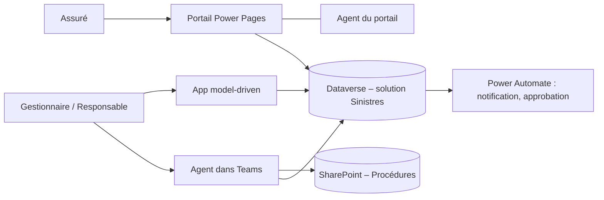
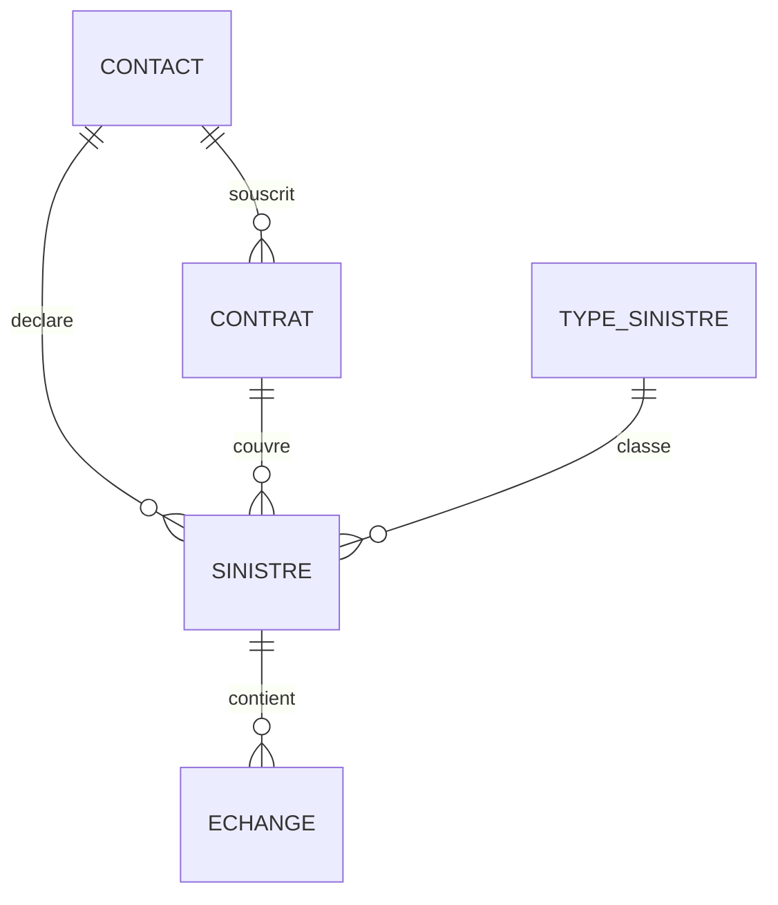

# Contoso Assurances – Déclaration de sinistres

Projet de démonstration sur la Power Platform : un portail où les assurés déclarent et suivent leurs sinistres, une application de gestion pour les équipes internes et deux agents Copilot Studio, le tout livré dans une solution et déployé par pipeline.

> Projet personnel, construit dans un environnement de développement. Les données et l'entreprise sont fictives.

## Sommaire

- [Contexte](#contexte)
- [Personas](#personas)
- [Récits utilisateur](#récits-utilisateur)
- [Architecture](#architecture)
- [Modèle de données](#modèle-de-données)
- [Règles métier](#règles-métier)
- [Écrans](#écrans)
- [Sécurité](#sécurité)
- [ALM et gouvernance](#alm-et-gouvernance)
- [Licences et coûts](#licences-et-coûts)
- [Limites rencontrées](#limites-rencontrées)
- [Hors périmètre](#hors-périmètre)
- [Démo](#démo)
- [Avancement](#avancement)

## Contexte

Contoso Assurances, un assureur fictif, reçoit les déclarations de sinistre de ses clients par courriel et par téléphone. Les dossiers sont suivis dans des fichiers Excel, les assurés n'ont aucune visibilité sur l'avancement et les gestionnaires cherchent les procédures dans plusieurs dossiers partagés.

Le projet remplace ce fonctionnement par :

- un **portail Power Pages** pour les assurés ;
- une **application model-driven** pour les gestionnaires et le responsable ;
- un **agent Copilot Studio dans Teams** pour les gestionnaires ;
- un **agent sur le portail** pour les assurés ;
- des **flux Power Automate** pour les notifications et les approbations.

## Personas

| Persona | Rôle | Outil principal |
| --- | --- | --- |
| Assuré | Client externe qui déclare un sinistre et suit son dossier | Portail Power Pages |
| Gestionnaire | Instruit les dossiers | App model-driven, agent dans Teams |
| Responsable | Approuve les indemnisations au-delà d'un seuil, pilote l'activité | App model-driven (tableau de bord) |

## Récits utilisateur

| N° | En tant que… | je veux… |
| --- | --- | --- |
| 1 | Assuré | me connecter et voir mes contrats |
| 2 | Assuré | déclarer un sinistre en ligne, avec mes pièces jointes |
| 3 | Assuré | suivre l'état de mes dossiers et être prévenu à chaque changement |
| 4 | Assuré | échanger un message avec mon gestionnaire |
| 5 | Assuré | poser une question sur la déclaration à l'agent du site |
| 6 | Gestionnaire | voir en un coup d'œil les dossiers à instruire |
| 7 | Gestionnaire | faire avancer un dossier étape par étape sans oublier d'information |
| 8 | Gestionnaire | demander à l'agent, dans Teams, une procédure ou l'état d'un dossier |
| 9 | Gestionnaire | obtenir le résumé d'un dossier et y ajouter une note |
| 10 | Responsable | approuver les indemnisations au-delà du seuil |
| 11 | Responsable | suivre les sinistres dans un tableau de bord |

## Architecture

Une seule base Dataverse sert les assurés, les gestionnaires et les deux agents. Il y a deux agents parce que les deux publics n'ont pas accès aux mêmes sources : un assuré externe n'a aucun droit sur SharePoint, alors que l'agent interne répond avec les droits du gestionnaire connecté.

## Modèle de données

| Table | Colonnes principales | Relations |
| --- | --- | --- |
| Type de sinistre | Nom, description, délai cible en jours | 1 type → plusieurs sinistres |
| Contrat | Numéro, formule (Essentiel, Confort, Intégral), date d'effet, statut | rattaché à un contact ; 1 contrat → plusieurs sinistres |
| Sinistre | Numéro automatique (S-0001…), date de survenance, date de déclaration, description, montant estimé, montant accordé, statut, délai depuis la déclaration (colonne formule) | rattaché à un contrat, un contact et un type ; 1 sinistre → plusieurs échanges |
| Échange | Message, auteur (assuré ou gestionnaire), date, pièce jointe | rattaché à un sinistre |
| Contact (table standard) | Nom, courriel | l'assuré qui se connecte au portail |

Statuts d'un sinistre : **Déclaré → Instruction → Expertise → Décision → Clôturé**, portés par un flux de processus métier.

## Règles métier

- Le montant estimé est obligatoire dès le statut Instruction.
- La date de survenance ne peut pas être postérieure à la date de déclaration.
- Au-delà de 5 000 € (seuil stocké dans une variable d'environnement), le responsable doit approuver avant la décision.
- L'assuré reçoit un courriel à chaque changement de statut.
- Un assuré ne voit que ses contrats, ses sinistres et ses échanges.
- L'agent interne ne cite que les documents que le gestionnaire connecté a le droit de lire.
- L'agent du portail ne répond que sur le contenu du site ; sinon il le dit et propose de transmettre à un gestionnaire.

## Écrans

- **Portail (assurés)** : Accueil, Mes contrats, Mes sinistres (liste, détail, échanges), Déclarer un sinistre (3 étapes), fenêtre de l'agent.
- **App model-driven** : vues des sinistres (« Mes sinistres ouverts », « À instruire », « Plus de 5 000 € »), formulaire Sinistre en onglets (Général, Instruction, Échanges) avec le flux de processus, Contrats, tableau de bord.
- **Teams** : l'agent « Assistant gestionnaire ».

## Sécurité

*À compléter au fil du projet.*

- **Back-office** : rôles de sécurité Dataverse Gestionnaire (ses dossiers) et Responsable (tous les dossiers).
- **Portail** : rôle web « Assuré », permissions de table en accès Contact sur Contrat et Sinistre, permission enfant sur Échange.
- **Preuve** : captures du test montrant qu'un assuré ne voit pas les dossiers d'un autre.

## ALM et gouvernance

*À compléter au fil du projet.*

- Tous les composants dans la solution « Sinistres », avec un éditeur et un préfixe dédiés.
- Deux environnements : Dev et Test.
- Variables d'environnement (adresse d'envoi, seuil d'approbation) et références de connexion.
- Déploiement par pipeline Dev → Test.
- Stratégie de données (DLP) appliquée à l'environnement Test.

## Licences et coûts

*À compléter : quelle licence pour quel utilisateur, et coût estimé des agents en crédits Copilot.*

## Choix du labo

*Décision prise le 28 octobre 2026.*

### Le contexte

Le projet tourne sur mon propre tenant Microsoft 365 Business Standard, dont je suis administrateur. Au départ, il utilisait deux environnements **développeur non gérés**, créés avec le Power Apps Developer Plan : **Dev** pour construire et **Test** comme cible du pipeline.

Microsoft retire ces environnements :

| Date | Ce qui change |
| --- | --- |
| 15 novembre 2026 | Plus de création d'environnement développeur non géré ; un seul environnement développeur **géré** par utilisateur |
| 15 décembre 2026 | Suspension des environnements développeur non gérés existants |
| 15 janvier 2027 | Début de leur suppression |

Sans action, tout le projet aurait été suspendu le 15 décembre.

### Les contraintes vérifiées

- **Un environnement développeur ne se convertit pas en sandbox** : seules les conversions production ↔ sandbox existent. Changer de type voulait dire recréer l'environnement et migrer la solution.
- **Un sandbox ou une production demande au moins 1 Go de capacité Dataverse** dans le tenant. Business Standard n'en apporte aucune : la page Capacité affichait 0 Mo de base de données, et la création d'un sandbox a été refusée.
- **Une licence d'essai n'apporte pas de capacité** : avec l'essai Power Apps Premium, la création restait refusée (« les licences d'essai peuvent uniquement créer des environnements de test »).
- **La cible d'un pipeline doit être un environnement géré.** La source (Dev) n'a pas besoin de l'être, mais un Dev non géré disparaît de toute façon en décembre.
- **Un environnement géré exige une licence premium** pour ses utilisateurs : les droits Managed Environments ne sont pas inclus dans le Developer Plan.
- **Le paiement à l'usage de Copilot Studio ne se branche que sur un sandbox ou une production**, pas sur un environnement développeur.

### Les options comparées

| Option | Coût | Pipeline possible | Limite |
| --- | --- | --- | --- |
| Ne rien faire | 0 € | Non | Projet suspendu le 15 décembre |
| Dev et Test en environnements d'essai | 0 € | Non (cible non gérée) | Expiration au bout de 30 jours |
| Dev en sandbox, Test en production | Licence + capacité | Oui | Migration complète, capacité nécessaire pour deux environnements |
| **Dev en développeur géré, Test en sandbox géré** | **Licence Power Apps Premium** | **Oui** | Sandbox seulement quand la licence payante est active |

### La décision

**Dev reste un environnement développeur, passé en géré. Test devient un sandbox géré.**

- Une seule licence **Power Apps Premium** couvre tout : les droits d'environnement géré et la capacité Dataverse du tenant.
- **Pas de migration** : la solution reste dans Dev, qui est simplement passé en géré le 28 octobre avec la licence d'essai.
- L'ancien Test développeur, vide, a été supprimé.
- Le **sandbox Test** sera créé le 30 novembre, quand la licence payante aura apporté de la capacité. Il est rattaché au groupe de sécurité `SG-PowerPlatform-Sinistres`, désormais obligatoire à la création.
- Pas d'environnement de production : pour un projet vitrine, un pipeline Dev → Test suffit à démontrer l'industrialisation. En contexte réel, j'ajouterais une étape Production avec une approbation avant déploiement.

### Ce que ça coûte

| Poste | Coût |
| --- | --- |
| Power Apps Premium, essai | Gratuit jusqu'au 28 novembre 2026 |
| Power Apps Premium, ensuite | 20,76 € HT par mois sans engagement, ou 207,60 € HT par an (17,30 € par mois) |
| Copilot Studio | Essai gratuit, puis paiement à l'usage (environ 0,01 $ par crédit) dans le sandbox, avec une alerte de budget Azure |

Microsoft augmente le prix de Power Apps Premium le 1er janvier 2027 (19,10 € HT par mois en annuel).

### Ce que ça implique pour la suite

- **Copilot Studio** : l'agent est construit dans Dev pendant l'essai. Après l'essai (vers le 8 février 2027), il tournera dans le sandbox Test, déployé par le pipeline, avec le paiement à l'usage.
- **Power Pages** : le site est créé dans Dev. Un site dans un environnement développeur ne peut pas passer en production, ce qui est sans conséquence pour une démonstration.
- **Capacité** : les tables système de Dataverse occupent de la place dans chaque environnement. En entreprise, on les purge régulièrement avec des travaux de suppression en bloc.

### Ce que j'en retiens

Le choix d'un labo n'est pas qu'un sujet technique : il croise le type d'environnement, la capacité Dataverse, les licences et le calendrier de Microsoft. C'est exactement la question qu'un client se pose quand il doit sortir de ses environnements développeur non gérés avant décembre 2026.

### Sources

- [Microsoft Learn – Fin des environnements développeur non gérés](https://learn.microsoft.com/en-us/power-platform/important-changes-coming)
- [Microsoft Learn – Pipelines dans Power Platform](https://learn.microsoft.com/en-us/power-platform/alm/pipelines)
- [Microsoft Learn – Changer le type d'un environnement](https://learn.microsoft.com/en-us/power-platform/admin/switch-environment)
- [Microsoft Learn – Capacité Dataverse](https://learn.microsoft.com/en-us/power-platform/admin/whats-new-storage)
- [Microsoft Learn – FAQ des licences Power Platform](https://learn.microsoft.com/en-us/power-platform/admin/powerapps-flow-licensing-faq)
- [Microsoft Learn – FAQ du paiement à l'usage](https://learn.microsoft.com/en-us/power-platform/admin/pay-as-you-go-issues-faq)

## Agent Copilot Studio – « Assistant gestionnaire »

*Démarré le 29 octobre 2026.*

### Le rôle de l'agent

L'agent interne aide les gestionnaires de Contoso Assurances à instruire les sinistres, depuis Teams.

| Récit | Ce que l'agent fait |
| --- | --- |
| 8 | Répond à une question de procédure (site SharePoint « Sinistres – Procédures ») ou donne l'état d'un dossier (Dataverse) |
| 9 | Résume un dossier et y ajoute une note (flux d'agent) |

Règles :

- il ne cite que ce que le gestionnaire connecté a le droit de lire ;
- face à une question hors périmètre, il le dit au lieu d'inventer.

### Les choix de configuration

| Sujet | Choix | Pourquoi |
| --- | --- | --- |
| Moteur (harness) | **Standard** (« Assistant ») | Seul moteur qui accepte les tables Dataverse comme connaissances et les rubriques (topics). Le moteur GitHub Copilot consomme des crédits même pendant les tests. |
| Environnement | **Dev** (développeur géré), dans la solution **Sinistres** | L'agent doit être déployé par le pipeline comme le reste de la solution. |
| Environnement d'équipe (Dataverse for Teams) | **Non** | Un environnement séparé, sans mes tables ni ma solution, inutilisable pour l'ALM. Teams sert seulement de canal de publication. |
| Modèle | **Auto** | Réglage par défaut. Je compare avec un modèle fixe lors de l'évaluation, plutôt que de prendre le plus puissant par principe. |
| Mémoire (préversion) | **Désactivée** | Des tests reproductibles. |
| Authentification | **Authentifier avec Microsoft** | Exigée pour les connaissances Dataverse, et c'est elle qui fait respecter les droits de chaque gestionnaire. |

### Instructions de l'agent

> Tu es l'assistant des gestionnaires de sinistres de Contoso Assurances.
> - Réponds en français, de façon brève et factuelle.
> - Pour une question de procédure, appuie-toi uniquement sur les documents du site « Sinistres – Procédures » et cite le document utilisé.
> - Pour une question sur un dossier, identifie-le par son numéro (format S-0001) et donne son statut, son type, ses montants et ses dates.
> - Si l'information n'est pas dans tes sources, dis-le clairement et n'invente rien.
> - Ne réponds pas aux questions sans rapport avec la gestion des sinistres.

### Connaissances Dataverse

**Prérequis :**

- la recherche Dataverse est activée dans l'environnement ;
- les tables Sinistre et Contrat sont indexées ;
- le numéro, la description et le statut figurent parmi les colonnes de recherche de la vue « Recherche rapide » de Sinistre.

La recherche Dataverse est un index plein texte, qui respecte les rôles de sécurité. C'est par elle que l'agent retrouve les bonnes lignes avant de rédiger sa réponse (principe du RAG).

#### Synonymes – table Sinistre

| Table ou colonne | Synonymes |
| --- | --- |
| Sinistre (table) | dossier, déclaration, sinistre déclaré, réclamation |
| Numéro | numéro de dossier, référence, n° de sinistre |
| Date de survenance | date du sinistre, date de l'incident, date de l'événement |
| Date de déclaration | date de la déclaration, déclaré le |
| Description | circonstances, détail, résumé des faits |
| Montant estimé | estimation, coût estimé, chiffrage, évaluation |
| Montant accordé | indemnisation, indemnité, montant versé, montant remboursé |
| Statut | état, avancement, étape, où en est |
| Délai depuis la déclaration | ancienneté, âge du dossier, nombre de jours |
| Type de sinistre | nature, catégorie, type de dommage |
| Contrat | police, contrat d'assurance |
| Contact | assuré, client, souscripteur |

#### Synonymes – table Contrat

| Table ou colonne | Synonymes |
| --- | --- |
| Contrat (table) | police, contrat d'assurance, garantie |
| Numéro | numéro de police, numéro de contrat, référence du contrat |
| Formule | niveau de garantie, offre, couverture |
| Date d'effet | date de début, date de souscription, prise d'effet |
| Statut | état du contrat, actif, résilié |
| Assuré | client, souscripteur, titulaire |

#### Glossaire

| Terme | Définition |
| --- | --- |
| S-0012 | Numéro d'un sinistre : « S- » suivi de 4 chiffres |
| Dossier | Synonyme de sinistre dans le langage des gestionnaires |
| Formule | Niveau de garantie d'un contrat : Essentiel, Confort ou Intégral |
| Essentiel | Formule de base |
| Confort | Formule intermédiaire |
| Intégral | Formule la plus complète |
| Déclaré | Sinistre reçu, pas encore pris en charge |
| En instruction | Sinistre dont le statut est « Instruction » : le gestionnaire vérifie la déclaration |
| En expertise | Sinistre dont le statut est « Expertise » : un expert évalue les dommages |
| Décision | Étape où l'indemnisation est accordée ou refusée |
| Clôturé | Sinistre terminé |
| Gros sinistre | Sinistre dont le montant estimé dépasse 5 000 € : l'indemnisation doit être approuvée par le responsable |
| Délai | Nombre de jours écoulés depuis la déclaration du sinistre |

### Ce que j'ai rencontré

- **Un essai déjà expiré.** La licence « Version d'évaluation de l'offre virale de Microsoft Copilot Studio » s'était attribuée automatiquement lors d'une première visite de Copilot Studio, sans courriel ni date visible. Elle avait expiré : les connaissances étaient bloquées jusqu'à la prolongation de 30 jours, faite le 29 octobre.
- **Une offre trompeuse dans le centre d'administration.** La « licence utilisateur Copilot Studio » à 0 € donne l'accès à Copilot Studio, mais pas les crédits qui font tourner les agents. Je ne l'ai pas prise.
- **Un mauvais moteur au premier essai.** Mon premier agent, créé depuis la solution, est parti sur le moteur GitHub Copilot : pas de connaissances Dataverse, et des crédits consommés dès les tests. Je l'ai supprimé et recréé sur le moteur standard. Le moteur se choisit à la création et ne se change pas après.
- **Coûts.** Les tests dans le panneau de test ne consomment pas de crédits sur le moteur standard. Les évaluations, les flux d'agent et les prompts en consomment. Sans pack de crédits ni paiement à l'usage, rien ne peut être facturé.

### Ce que j'en retiens

Avant de construire un agent, trois choix décident de tout : le moteur, l'environnement et la licence. Ils déterminent ce que l'agent peut faire, où il peut être déployé et combien il coûte. Un client qui démarre Copilot Studio se heurte aux mêmes pièges.

### Sources

- [Microsoft Learn – Ajouter des tables Dataverse comme connaissances](https://learn.microsoft.com/en-us/microsoft-copilot-studio/knowledge-add-dataverse)
- [Microsoft Learn – Les moteurs (harnesses) de Copilot Studio](https://learn.microsoft.com/en-us/microsoft-copilot-studio/harnesses-overview)
- [Microsoft Learn – Changer d'expérience](https://learn.microsoft.com/en-us/microsoft-copilot-studio/agents-experience/switch-experiences)
- [Microsoft Learn – FAQ facturation et licences Copilot Studio](https://learn.microsoft.com/en-us/microsoft-copilot-studio/faq-billing-licensing)
- [Microsoft Learn – S'inscrire à un essai Copilot Studio](https://learn.microsoft.com/microsoft-copilot-studio/sign-up-individual)

## Limites rencontrées

*À compléter : ce qui n'a pas fonctionné comme prévu, et pourquoi.*

## Hors périmètre

Paiement des indemnités, gestion des experts, multilingue, données réelles.

## Démo

*Liens à ajouter :*

- Vidéo back-office (1 min)
- Vidéo portail (1 min)
- Vidéo agent dans Teams (1 min)
- Démo complète (3 min)

## Avancement

- [ ] Phase 0 – Mise en place
- [ ] Phase 1 – Dataverse et model-driven
- [ ] Phase 2 – Power Pages
- [ ] Phase 3 – Copilot Studio
- [ ] Phase 4 – Industrialisation et vitrine
- [ ] Phase 5 – Administration
- [ ] Phase 6 – Agents avancés

## Auteur

Igor Doussot – consultant senior Power Platform et SharePoint.
