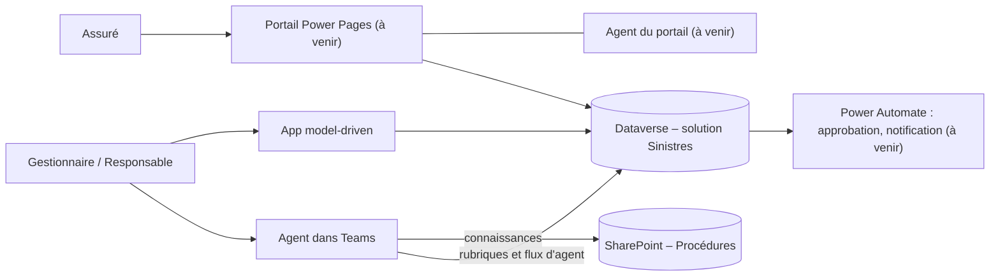
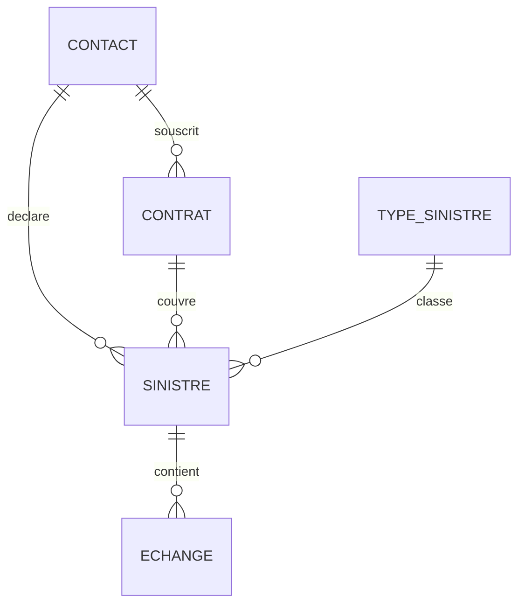
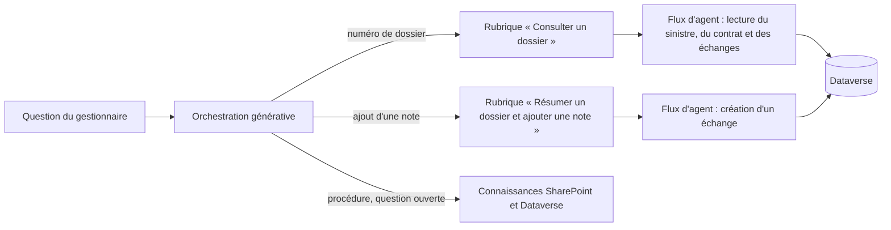

# Contoso Assurances – Déclaration de sinistres

Projet de démonstration sur la Power Platform : une application de gestion des sinistres sur Dataverse, un agent Copilot Studio dans Teams pour les gestionnaires, puis un portail Power Pages où les assurés déclarent et suivent leurs sinistres. Le tout est construit dans une solution, versionnée sur GitHub.

> Projet personnel, construit dans un environnement de développement. Les données et l'entreprise sont fictives.

## Démo

Consultation d'un dossier, ajout d'une note, vérification dans Dataverse et procédure interne, depuis Teams.

https://github.com/user-attachments/assets/bc1fc751-dde3-4d44-9181-fde113dd6dfa

## Où en est le projet

| Brique | État |
| --- | --- |
| Modèle de données Dataverse et application model-driven | Livré (28 octobre 2026) |
| Règles métier, flux de processus métier, rôles de sécurité, flux d'approbation | Livré |
| Courriel à l'assuré à chaque changement de statut | À venir |
| Agent Copilot Studio « Assistant de gestionnaire » dans Teams | Livré (9 novembre 2026) ; évaluation et cas d'échec en cours |
| Portail Power Pages et agent du portail | À venir (novembre – décembre 2026) |
| Sandbox Test et déploiement par pipeline | À venir (à partir du 30 novembre 2026) |

## Sommaire

- [Contexte](#contexte)
- [Personas](#personas)
- [Récits utilisateur](#récits-utilisateur)
- [Architecture](#architecture)
- [Modèle de données](#modèle-de-données)
- [Règles métier](#règles-métier)
- [Écrans](#écrans)
- [Sécurité](#sécurité)
- [ALM et gouvernance](#alm-et-gouvernance)
- [Licences et coûts](#licences-et-coûts)
- [Choix du labo](#choix-du-labo)
- [Agent Copilot Studio](#agent-copilot-studio)
- [Limites rencontrées](#limites-rencontrées)
- [Hors périmètre](#hors-périmètre)
- [Avancement](#avancement)

## Contexte

Contoso Assurances, un assureur fictif, reçoit les déclarations de sinistre de ses clients par courriel et par téléphone. Les dossiers sont suivis dans des fichiers Excel, les assurés n'ont aucune visibilité sur l'avancement et les gestionnaires cherchent les procédures dans plusieurs dossiers partagés.

Le projet remplace ce fonctionnement par :

- une **application model-driven** pour les gestionnaires et le responsable ;
- un **agent Copilot Studio dans Teams** pour les gestionnaires ;
- des **flux Power Automate** pour les approbations, puis pour les notifications aux assurés (à venir) ;
- un **portail Power Pages** pour les assurés (à venir) ;
- un **agent sur le portail** pour les assurés (à venir).

## Personas

| Persona | Rôle | Outil principal |
| --- | --- | --- |
| Assuré | Client externe qui déclare un sinistre et suit son dossier | Portail Power Pages |
| Gestionnaire | Instruit les dossiers | App model-driven, agent dans Teams |
| Responsable | Approuve les indemnisations au-delà d'un seuil, pilote l'activité | App model-driven (tableau de bord) |

## Récits utilisateur

| N° | En tant que… | je veux… | État |
| --- | --- | --- | --- |
| 1 | Assuré | me connecter et voir mes contrats | À venir |
| 2 | Assuré | déclarer un sinistre en ligne, avec mes pièces jointes | À venir |
| 3 | Assuré | suivre l'état de mes dossiers et être prévenu à chaque changement | À venir |
| 4 | Assuré | échanger un message avec mon gestionnaire | À venir |
| 5 | Assuré | poser une question sur la déclaration à l'agent du site | À venir |
| 6 | Gestionnaire | voir en un coup d'œil les dossiers à instruire | Livré |
| 7 | Gestionnaire | faire avancer un dossier étape par étape sans oublier d'information | Livré |
| 8 | Gestionnaire | demander à l'agent, dans Teams, une procédure ou l'état d'un dossier | Livré |
| 9 | Gestionnaire | obtenir le résumé d'un dossier et y ajouter une note | Livré |
| 10 | Responsable | approuver les indemnisations au-delà du seuil | Livré |
| 11 | Responsable | suivre les sinistres dans un tableau de bord | Livré |

## Architecture

Une seule base Dataverse sert les assurés, les gestionnaires et les deux agents. Il y a deux agents parce que les deux publics n'ont pas accès aux mêmes sources : un assuré externe n'a aucun droit sur SharePoint, alors que l'agent interne s'adresse aux gestionnaires.

## Modèle de données

| Table | Colonnes principales | Relations |
| --- | --- | --- |
| Type de sinistre | Nom, description, délai cible en jours | 1 type → plusieurs sinistres |
| Contrat | Numéro, formule (Essentiel, Confort, Intégral), date d'effet, statut | rattaché à un assuré ; 1 contrat → plusieurs sinistres |
| Sinistre | Numéro de sinistre automatique (S-0001…), date de survenance, date de déclaration, description, montant estimé, montant accordé, statut, délai depuis la déclaration (colonne formule) | rattaché à un contrat, un assuré et un type ; 1 sinistre → plusieurs échanges |
| Échange | Message, auteur (assuré ou gestionnaire), date | rattaché à un sinistre ; la suppression d'un sinistre qui a des échanges est bloquée (relation en « Restreindre ») |
| Contact | Nom, prénom, courriel | l'assuré ; à ce stade une table du projet, à relier à la table Contact standard pour l'authentification du portail |

Statuts d'un sinistre : **Déclaré → Instruction → Expertise → Décision → Clôturé**. Le statut est une colonne de choix ; un flux de processus métier guide le gestionnaire à travers les mêmes étapes. Les deux ne sont pas synchronisés automatiquement (voir [Limites rencontrées](#limites-rencontrées)).

## Règles métier

- Le montant estimé est obligatoire dès le statut Instruction.
- La date de survenance ne peut pas être postérieure à la date de déclaration.
- Le montant accordé ne peut pas dépasser le montant estimé.
- Au-delà de 5 000 € (seuil stocké dans une variable d'environnement), le responsable doit approuver avant la décision.
- L'assuré reçoit un courriel à chaque changement de statut (à venir).
- Un assuré ne voit que ses contrats, ses sinistres et ses échanges (portail, à venir).
- L'agent interne ne répond qu'à partir de ses sources et le dit quand l'information n'y figure pas.
- L'agent du portail ne répondra que sur le contenu du site ; sinon il le dira et proposera de transmettre à un gestionnaire (à venir).

## Écrans

- **App model-driven** : vues des sinistres, formulaire Sinistre en onglets (Sinistre, Données financières, Statut, Échanges) avec le flux de processus métier, Contrats, tableau de bord de suivi.
- **Teams** : l'agent « Assistant de gestionnaire ».
- **Portail (assurés, à venir)** : Accueil, Mes contrats, Mes sinistres (liste, détail, échanges), Déclarer un sinistre (3 étapes), fenêtre de l'agent.

## Sécurité

- **Back-office** : rôles de sécurité Dataverse Gestionnaire (ses dossiers) et Responsable (tous les dossiers), avec une équipe propriétaire.
- **Protection des données** : un sinistre qui a des échanges ne peut pas être supprimé (relation en « Restreindre »). La corbeille Dataverse n'est pas disponible dans un environnement développeur ; elle sera activée sur le sandbox Test.
- **Agent** : authentification Microsoft. Les flux d'agent s'exécutent pour l'instant avec les identifiants de l'auteur, ce qui est acceptable pour une démonstration à un seul utilisateur. En production, je passerais aux identifiants de l'utilisateur final ou à un compte de service à privilèges minimaux, pour que les rôles de sécurité s'appliquent aussi aux actions de l'agent.
- **Portail (à venir)** : rôle web « Assuré », permissions de table en accès Contact sur Contrat et Sinistre, permission enfant sur Échange. Preuve prévue : captures du test montrant qu'un assuré ne voit pas les dossiers d'un autre.

## ALM et gouvernance

- Tous les composants sont dans la solution « Sinistres », avec un éditeur et un préfixe dédiés : tables, application, flux, agent, rubriques, flux d'agent.
- La solution est exportée, dépliée avec la CLI Power Platform (`pac solution unpack`) et versionnée dans ce dépôt, dans `src/Sinistres`.
- Variables d'environnement (adresse d'envoi, seuil d'approbation) et références de connexion.
- Environnements : Dev, un environnement développeur géré. Le sandbox Test sera créé le 30 novembre 2026 (voir [Choix du labo](#choix-du-labo)).
- À venir : déploiement par pipeline Dev → Test, stratégie de données (DLP) sur l'environnement Test.

## Licences et coûts

Les licences du labo et leur coût sont détaillés dans [Choix du labo](#choix-du-labo).

*À compléter : quelle licence pour quel utilisateur dans un contexte réel, et coût estimé des agents en crédits Copilot.*

## Choix du labo

*Décision prise le 28 octobre 2026.*

### Le contexte

Le projet tourne sur mon propre tenant Microsoft 365 Business Standard, dont je suis administrateur. Au départ, il utilisait deux environnements **développeur non gérés**, créés avec le Power Apps Developer Plan : **Dev** pour construire et **Test** comme cible du pipeline.

Microsoft retire ces environnements :

| Date | Ce qui change |
| --- | --- |
| 15 novembre 2026 | Plus de création d'environnement développeur non géré ; un seul environnement développeur **géré** par utilisateur |
| 15 décembre 2026 | Suspension des environnements développeur non gérés existants |
| 15 janvier 2027 | Début de leur suppression |

Sans action, tout le projet aurait été suspendu le 15 décembre.

### Les contraintes vérifiées

- **Un environnement développeur ne se convertit pas en sandbox** : seules les conversions production ↔ sandbox existent. Changer de type voulait dire recréer l'environnement et migrer la solution.
- **Un sandbox ou une production demande au moins 1 Go de capacité Dataverse** dans le tenant. Business Standard n'en apporte aucune : la page Capacité affichait 0 Mo de base de données, et la création d'un sandbox a été refusée.
- **Une licence d'essai n'apporte pas de capacité** : avec l'essai Power Apps Premium, la création restait refusée (« les licences d'essai peuvent uniquement créer des environnements de test »).
- **La cible d'un pipeline doit être un environnement géré.** La source (Dev) n'a pas besoin de l'être, mais un Dev non géré disparaît de toute façon en décembre.
- **Un environnement géré exige une licence premium** pour ses utilisateurs : les droits Managed Environments ne sont pas inclus dans le Developer Plan.
- **Le paiement à l'usage de Copilot Studio ne se branche que sur un sandbox ou une production**, pas sur un environnement développeur.

### Les options comparées

| Option | Coût | Pipeline possible | Limite |
| --- | --- | --- | --- |
| Ne rien faire | 0 € | Non | Projet suspendu le 15 décembre |
| Dev et Test en environnements d'essai | 0 € | Non (cible non gérée) | Expiration au bout de 30 jours |
| Dev en sandbox, Test en production | Licence + capacité | Oui | Migration complète, capacité nécessaire pour deux environnements |
| **Dev en développeur géré, Test en sandbox géré** | **Licence Power Apps Premium** | **Oui** | Sandbox seulement quand la licence payante est active |

### La décision

**Dev reste un environnement développeur, passé en géré. Test devient un sandbox géré.**

- Une seule licence **Power Apps Premium** couvre tout : les droits d'environnement géré et la capacité Dataverse du tenant.
- **Pas de migration** : la solution reste dans Dev, qui est simplement passé en géré le 28 octobre avec la licence d'essai.
- L'ancien Test développeur, vide, a été supprimé.
- Le **sandbox Test** sera créé le 30 novembre, quand la licence payante aura apporté de la capacité. Il est rattaché au groupe de sécurité `SG-PowerPlatform-Sinistres`, désormais obligatoire à la création.
- Pas d'environnement de production : pour un projet vitrine, un pipeline Dev → Test suffit à démontrer l'industrialisation. En contexte réel, j'ajouterais une étape Production avec une approbation avant déploiement.

### Ce que ça coûte

| Poste | Coût |
| --- | --- |
| Power Apps Premium, essai | Gratuit jusqu'au 28 novembre 2026 |
| Power Apps Premium, ensuite | 20,76 € HT par mois sans engagement, ou 207,60 € HT par an (17,30 € par mois) |
| Copilot Studio | Essai gratuit, puis paiement à l'usage (environ 0,01 $ par crédit) dans le sandbox, avec une alerte de budget Azure |

Microsoft augmente le prix de Power Apps Premium le 1er janvier 2027 (19,10 € HT par mois en annuel).

### Ce que ça implique pour la suite

- **Copilot Studio** : l'agent est construit dans Dev pendant l'essai. À la fin de l'essai (au plus tard fin janvier 2027, plus tôt si une prolongation est refusée), il tournera dans le sandbox Test, déployé par le pipeline, avec le paiement à l'usage.
- **Power Pages** : le site est créé dans Dev. Un site dans un environnement développeur ne peut pas passer en production, ce qui est sans conséquence pour une démonstration.
- **Capacité** : les tables système de Dataverse occupent de la place dans chaque environnement. En entreprise, on les purge régulièrement avec des travaux de suppression en bloc.

### Ce que j'en retiens

Le choix d'un labo n'est pas qu'un sujet technique : il croise le type d'environnement, la capacité Dataverse, les licences et le calendrier de Microsoft. C'est exactement la question qu'un client se pose quand il doit sortir de ses environnements développeur non gérés avant décembre 2026.

### Sources

- [Microsoft Learn – Fin des environnements développeur non gérés](https://learn.microsoft.com/en-us/power-platform/important-changes-coming)
- [Microsoft Learn – Pipelines dans Power Platform](https://learn.microsoft.com/en-us/power-platform/alm/pipelines)
- [Microsoft Learn – Changer le type d'un environnement](https://learn.microsoft.com/en-us/power-platform/admin/switch-environment)
- [Microsoft Learn – Capacité Dataverse](https://learn.microsoft.com/en-us/power-platform/admin/whats-new-storage)
- [Microsoft Learn – FAQ des licences Power Platform](https://learn.microsoft.com/en-us/power-platform/admin/powerapps-flow-licensing-faq)
- [Microsoft Learn – FAQ du paiement à l'usage](https://learn.microsoft.com/en-us/power-platform/admin/pay-as-you-go-issues-faq)

## Agent Copilot Studio

*Agent « Assistant de gestionnaire », démarré le 29 octobre 2026 et publié dans Teams le 9 novembre 2026.*

### Le rôle de l'agent

L'agent interne aide les gestionnaires de Contoso Assurances à instruire les sinistres, depuis Teams.

| Récit | Ce que l'agent fait | Par quel moyen |
| --- | --- | --- |
| 8 | Répond à une question de procédure | Connaissances : site SharePoint « Sinistres – Procédures » |
| 8 | Donne l'état complet d'un dossier à partir de son numéro | Rubrique « Consulter un dossier » + flux d'agent qui lit Dataverse |
| 9 | Ajoute une note à un dossier | Rubrique « Résumer un dossier et ajouter une note » + flux d'agent qui écrit dans la table Échange |
| — | Répond à une question ouverte sur les dossiers et les contrats | Connaissances : tables Dataverse Sinistre et Contrat |

Règles :

- il ne répond qu'à partir de ses sources ;
- face à une question hors périmètre, il le dit au lieu d'inventer.

### Comment il est construit

- **Deux rubriques avec des entrées** (numéro du dossier, texte de la note) : l'orchestrateur extrait les valeurs de la phrase et ne pose une question que si l'une d'elles manque.
- **Deux flux d'agent** : l'un retrouve le dossier par son numéro et renvoie une fiche en texte (statut, type, assuré, contrat, montants, dates, dernières notes) ; l'autre ajoute une note. Les deux gèrent le cas d'un numéro inexistant.
- **Des sorties de rubrique** : la fiche est transmise à l'orchestrateur, qui la met en forme.

### Les choix de configuration

| Sujet | Choix | Pourquoi |
| --- | --- | --- |
| Moteur (harness) | **Standard** (« Assistant ») | Seul moteur qui accepte les tables Dataverse comme connaissances et les rubriques (topics). Le moteur GitHub Copilot consomme des crédits même pendant les tests. |
| Orchestration | **Générative** | L'agent choisit la rubrique, l'outil ou la connaissance d'après leur description. |
| Environnement | **Dev** (développeur géré), dans la solution **Sinistres** | L'agent doit être déployé par le pipeline comme le reste de la solution. |
| Environnement d'équipe (Dataverse for Teams) | **Non** | Un environnement séparé, sans mes tables ni ma solution, inutilisable pour l'ALM. Teams sert seulement de canal de publication. |
| Modèle | **Auto** | Réglage par défaut. Je compare avec un modèle fixe lors de l'évaluation, plutôt que de prendre le plus puissant par principe. |
| Mémoire (préversion) | **Désactivée** | Des tests reproductibles. |
| Authentification | **Authentifier avec Microsoft** | Exigée pour les connaissances Dataverse. |
| Consultation d'un dossier | **Flux d'agent**, pas les connaissances | Pour un identifiant exact, la recherche sémantique n'était pas fiable (voir ci-dessous). |

### Instructions de l'agent

> Tu es l'assistant gestionnaire dédié aux sinistres. Ton rôle est d'assister le gestionnaire qui te sollicite pour connaître :
> - une procédure concernant un sinistre ;
> - l'état d'un dossier ;
> - lui faire le résumé d'un dossier.
>
> Tu ne dois citer que les documents que le gestionnaire connecté a le droit de lire. Tu ne dois pas inventer. Si une question est hors de ton périmètre, dis-le au lieu d'inventer.
>
> Tes sources sont le site SharePoint que je t'ai partagé, les tables Dataverse Sinistre et Contrat.
>
> Lors d'une question sur un dossier, identifie-le par son numéro (exemple de format : S-0001). Donne son statut, son type, ses montants et dates. N'invente rien.
>
> Pour ajouter une note à un dossier, utilise toujours la rubrique « Résumer un dossier et ajouter une note ». Ne dis jamais que tu ne peux pas ajouter de note.
>
> Ne fais aucune supposition au-delà des données renvoyées. Si une information manque, dis seulement qu'elle n'est pas disponible.
>
> Dès que l'utilisateur mentionne un numéro de dossier (S-xxxx), utilise toujours la rubrique « Consulter un dossier » plutôt que les connaissances.
>
> Présente les fiches de dossier sous forme de liste à puces, sans rien ajouter qui ne figure pas dans les données.
>
> Si la question n'a aucun rapport avec les sinistres, les contrats ou les procédures, ne cherche pas dans tes sources et réponds uniquement : « Je suis l'assistant des gestionnaires de sinistres : je peux vous aider sur les dossiers, les contrats et les procédures internes. »

### Connaissances

**SharePoint** : le site « Sinistres – Procédures », avec la procédure de déclaration, le barème, la FAQ et la procédure « Dégât des eaux » (PROC-DDE-01).

**Dataverse** : les tables Sinistre et Contrat, avec une description de la source, des synonymes et un glossaire. Prérequis :

- la recherche Dataverse est activée dans l'environnement ;
- les tables Sinistre et Contrat sont indexées ;
- le numéro, la description et le statut figurent parmi les colonnes de recherche de la vue « Recherche rapide » de Sinistre.

La recherche Dataverse est un index plein texte, qui respecte les rôles de sécurité. C'est par elle que l'agent retrouve les bonnes lignes avant de rédiger sa réponse (principe du RAG).

#### Synonymes – table Sinistre

| Table ou colonne | Synonymes |
| --- | --- |
| Sinistre (table) | dossier, déclaration, sinistre déclaré, réclamation |
| Numéro de sinistre | numéro de dossier, référence, n° de sinistre |
| Date de survenance | date du sinistre, date de l'incident, date de l'événement |
| Date de déclaration | date de la déclaration, déclaré le |
| Description | circonstances, détail, résumé des faits |
| Montant estimé | estimation, coût estimé, chiffrage, évaluation |
| Montant accordé | indemnisation, indemnité, montant versé, montant remboursé |
| Statut | état, avancement, étape, où en est |
| Délai depuis la déclaration | ancienneté, âge du dossier, nombre de jours |
| Type de sinistre | nature, catégorie, type de dommage |
| Contrat | police, contrat d'assurance |
| Assuré | client, souscripteur |

#### Synonymes – table Contrat

| Table ou colonne | Synonymes |
| --- | --- |
| Contrat (table) | police, contrat d'assurance, garantie |
| Numéro | numéro de police, numéro de contrat, référence du contrat |
| Formule | niveau de garantie, offre, couverture |
| Date d'effet | date de début, date de souscription, prise d'effet |
| Statut | état du contrat, actif, résilié |
| Assuré | client, souscripteur, titulaire |

#### Glossaire

| Terme | Définition |
| --- | --- |
| S-0012 | Numéro d'un sinistre : « S- » suivi de 4 chiffres |
| Dossier | Synonyme de sinistre dans le langage des gestionnaires |
| Formule | Niveau de garantie d'un contrat : Essentiel, Confort ou Intégral |
| Essentiel | Formule de base |
| Confort | Formule intermédiaire |
| Intégral | Formule la plus complète |
| Déclaré | Sinistre reçu, pas encore pris en charge |
| En instruction | Sinistre dont le statut est « Instruction » : le gestionnaire vérifie la déclaration |
| En expertise | Sinistre dont le statut est « Expertise » : un expert évalue les dommages |
| Décision | Étape où l'indemnisation est accordée ou refusée |
| Clôturé | Sinistre terminé |
| Gros sinistre | Sinistre dont le montant estimé dépasse 5 000 € : l'indemnisation doit être approuvée par le responsable |
| Délai | Nombre de jours écoulés depuis la déclaration du sinistre |

### Ce que j'ai rencontré

**Licences et moteur**

- **Un essai déjà expiré.** La licence « Version d'évaluation de l'offre virale de Microsoft Copilot Studio » s'était attribuée automatiquement lors d'une première visite de Copilot Studio, sans courriel ni date visible. Elle avait expiré : les connaissances étaient bloquées jusqu'à la prolongation de 30 jours, faite le 29 octobre.
- **Une offre trompeuse dans le centre d'administration.** La « licence utilisateur Copilot Studio » à 0 € donne l'accès à Copilot Studio, mais pas les crédits qui font tourner les agents. Je ne l'ai pas prise.
- **Un mauvais moteur au premier essai.** Mon premier agent, créé depuis la solution, est parti sur le moteur GitHub Copilot : pas de connaissances Dataverse, et des crédits consommés dès les tests. Je l'ai supprimé et recréé sur le moteur standard. Le moteur se choisit à la création et ne se change pas après.
- **Coûts.** Sans pack de crédits ni paiement à l'usage, rien ne peut être facturé. Les flux d'agent et les évaluations consomment en revanche l'allocation de l'essai : une seule évaluation de dix questions a suffi à atteindre la limite d'usage.

**Fiabilité des réponses**

- **Identifiant exact : un outil déterministe, pas la recherche sémantique.** Pour « Où en est le dossier S-0012 ? », les connaissances Dataverse trouvaient le dossier une fois sur deux, selon la reformulation de la recherche. Une rubrique et un flux d'agent qui filtre sur le numéro donnent la même réponse à chaque fois. Les connaissances restent pour les questions ouvertes et les procédures.
- **Un agent ne répond pas mieux que les données qu'on lui transmet.** Le flux renvoyait d'abord le JSON brut de Dataverse : l'agent n'y voyait que des champs système. Avec une fiche en texte, construite à partir des valeurs formatées, la réponse est juste et complète.
- **Le fuseau horaire.** Une date saisie le 13 septembre est stockée « 12 septembre à 22 h UTC ». L'agent affichait le 12. Le flux utilise désormais la valeur formatée dans le fuseau de l'utilisateur.
- **Les sorties de rubrique.** Le résultat du flux doit être associé à une variable de sortie de la rubrique pour arriver jusqu'à l'orchestrateur. Après chaque changement des sorties du flux, le nœud de la rubrique est à rafraîchir.

**Dataverse et Power Automate**

- **On cherche avec le numéro, on relie avec le GUID.** Pour rattacher un échange à un sinistre, il faut l'identifiant technique de la ligne, pas « S-0012 ». Pour filtrer sur une colonne de recherche, la syntaxe est `_nom_value eq GUID`, sans apostrophes.
- **Des réponses de flux au schéma identique.** Quand un flux d'agent a plusieurs actions de réponse (dossier trouvé ou introuvable), elles doivent renvoyer exactement les mêmes sorties.
- **Une numérotation mal formatée.** Le format de numérotation automatique produisait « S--0012 ». L'agent l'a signalé lui-même. J'ai corrigé le format, puis les lignes existantes avec un script PowerShell (module Microsoft.Xrm.Data.PowerShell).
- **Une suppression accidentelle.** Un dossier de test supprimé par erreur n'a pas pu être restauré : la corbeille Dataverse n'est pas disponible dans un environnement développeur. J'ai recréé la ligne par script, puis verrouillé la suppression par la règle de relation.

**Publication**

- **Les flux d'agent s'exécutent avec les identifiants de l'auteur.** Copilot Studio le signale à la publication. Acceptable pour une démonstration à un seul utilisateur ; en production, je passerais aux identifiants de l'utilisateur final ou à un compte de service à privilèges minimaux.
- **Les rubriques système ont leurs propres messages.** Une question hors périmètre déclenche la rubrique de secours, dont le message générique ne dépend pas des instructions de l'agent. À personnaliser à part.
- **Un jeu d'évaluation généré en anglais.** Le jeu de tests proposé automatiquement était en anglais et sans rapport avec le cahier des charges. Je le remplace par mes propres questions, en français, avec leur réponse attendue.

### Ce que j'en retiens

Avant de construire un agent, trois choix décident de tout : le moteur, l'environnement et la licence. Ensuite, la fiabilité se joue dans l'architecture : un outil déterministe pour ce qui doit être exact, des connaissances pour ce qui est ouvert, et des données propres transmises au modèle. Un agent reste une application, avec les mêmes exigences de sécurité et d'industrialisation.

### Sources

- [Microsoft Learn – Ajouter des tables Dataverse comme connaissances](https://learn.microsoft.com/en-us/microsoft-copilot-studio/knowledge-add-dataverse)
- [Microsoft Learn – Les moteurs (harnesses) de Copilot Studio](https://learn.microsoft.com/en-us/microsoft-copilot-studio/harnesses-overview)
- [Microsoft Learn – Changer d'expérience](https://learn.microsoft.com/en-us/microsoft-copilot-studio/agents-experience/switch-experiences)
- [Microsoft Learn – FAQ facturation et licences Copilot Studio](https://learn.microsoft.com/en-us/microsoft-copilot-studio/faq-billing-licensing)
- [Microsoft Learn – S'inscrire à un essai Copilot Studio](https://learn.microsoft.com/microsoft-copilot-studio/sign-up-individual)

## Limites rencontrées

- **Statut et processus métier non synchronisés.** Changer la colonne Statut ne fait pas avancer le flux de processus métier, et inversement. En production, je garderais une seule source de vérité : soit un flux qui met à jour le statut au changement d'étape, soit l'étape du processus comme seul statut.
- **Libellés système en anglais.** Certains libellés de l'application (« Save & Close », « Related ») restent en anglais malgré la langue configurée en français, dans cet environnement développeur.
- **Pas de corbeille Dataverse** dans un environnement développeur : une suppression y est définitive.
- **Limites de l'essai Copilot Studio** : une évaluation consomme vite l'allocation, et la publication durable d'un agent qui utilise des fonctions premium demande une capacité payante.
- **Agent et droits des utilisateurs** : tant que les flux d'agent utilisent les identifiants de l'auteur, les rôles de sécurité Dataverse ne s'appliquent pas aux actions de l'agent.

## Hors périmètre

Paiement des indemnités, gestion des experts, multilingue, données réelles.

## Avancement

- [x] Phase 0 – Mise en place
- [x] Phase 1 – Dataverse et model-driven (28 octobre 2026)
- [x] Labo – passage en environnement géré (28 octobre 2026)
- [ ] Phase 2 – Copilot Studio : agent publié dans Teams (9 novembre 2026) ; évaluation et cas d'échec en cours
- [ ] Phase 3 – Power Pages
- [ ] Phase 4 – Industrialisation et vitrine
- [ ] Phase 5 – Administration
- [ ] Phase 6 – Agents avancés

## Auteur

Igor Doussot – consultant senior Power Platform et SharePoint.
